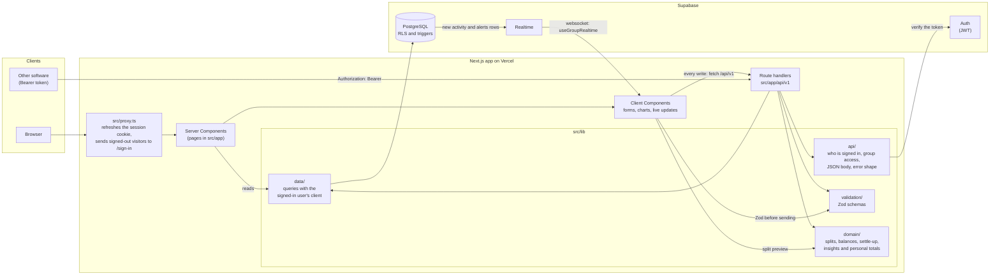
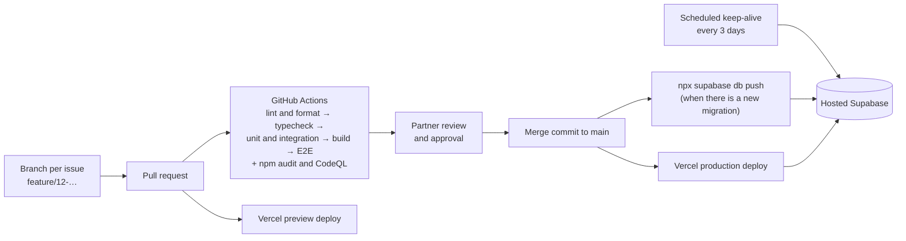

# Architecture

CommonPot is one Next.js app on Vercel in front of one Supabase project. The browser and other software use the same REST API for every change, and the database checks permissions again with row level security, so a rule holds even if a request skips the UI.

## Overview



| Layer             | Where                        | Job                                                                                                                                                                                            |
| ----------------- | ---------------------------- | ---------------------------------------------------------------------------------------------------------------------------------------------------------------------------------------------- |
| Proxy             | `src/proxy.ts`               | Refreshes the Supabase session cookie on every page request, sends signed-out visitors to `/sign-in?next=…` and back afterwards. It skips `/api`: routes answer 401 themselves                 |
| Pages             | `src/app/**/page.tsx`        | Server Components by default. They read through `lib/data` with the signed-in user's client, so RLS decides what they see                                                                      |
| Interactive parts | `src/components/<feature>/`  | Client Components only where needed: forms, charts, dialogs and live updates. They never write to Supabase directly                                                                            |
| API               | `src/app/api/v1/**/route.ts` | The only write path, also used by other software. Documented in [openapi.yaml](api/openapi.yaml) and served as Swagger UI at `/api/docs`                                                       |
| Route helpers     | `src/lib/api/`               | `getAuthenticatedSupabase` (session cookie or Bearer token; a suspended account counts as signed out), `requireGroupMember`, `requireAdmin`, `requireSiteAdmin`, `readJsonBody` and `apiError` |
| Validation        | `src/lib/validation/`        | Zod schemas shared by the forms and the routes, so both reject the same input                                                                                                                  |
| Business logic    | `src/lib/domain/`            | Pure functions with no React, Next.js or Supabase imports: splits, balances, settle-up suggestions, insights and personal totals. Unit tested with 80% line coverage or more                   |
| Data access       | `src/lib/data/`              | Supabase queries with the signed-in user's client                                                                                                                                              |
| Database          | `supabase/migrations/`       | Tables, RLS policies, triggers and functions; see [database.md](database.md)                                                                                                                   |

The full folder layout, naming rules and patterns for contributors are in [AGENTS.md](../AGENTS.md#architecture).

## One request, start to finish: logging an expense

```mermaid
sequenceDiagram
  actor a as Member A
  participant form as ExpenseForm (A's browser)
  participant route as POST /api/v1/groups/{groupId}/expenses
  participant db as PostgreSQL
  participant rt as Supabase Realtime
  participant b as Member B's browser

  a->>form: amount, description, split, Save
  form->>form: Zod checks the form; lib/domain works out each share
  form->>route: JSON with the session cookie
  route->>route: signed in? valid group id? JSON? Zod again
  route->>db: rpc create_expense (runs as the user, so RLS applies)
  db->>db: triggers check the shares add up and write an activity row
  db-->>route: the new expense id
  route-->>form: 201 { id }
  db-)rt: new activity row
  rt-)b: postgres_changes event (RLS: B is a member)
  b->>b: useGroupRealtime waits 200 ms for more changes
  b->>route: GET the expenses again, refresh balances and the feed
```

If the database refuses (for example, a share holder isn't in the group), the route answers `422` with `{ "error": { "code": "INVALID_EXPENSE", "message": "…" } }`, and the form shows the message.

## Design decisions

| Decision                                                                                               | Why                                                                                                                                                                                               | Record                                                       |
| ------------------------------------------------------------------------------------------------------ | ------------------------------------------------------------------------------------------------------------------------------------------------------------------------------------------------- | ------------------------------------------------------------ |
| Next.js, Supabase and Vercel, on current stable versions                                               | The stack recommended in class, which agents write well; Supabase gives PostgreSQL, JWT auth and realtime in one service, and Vercel a preview for every PR, both free                            | [ADR 0001](decisions/0001-stack-and-versions.md)             |
| Pages read through `lib/data`; every write goes through `/api/v1` (no Server Actions)                  | Permissions are checked in one place, and other software gets the same API as the UI                                                                                                              | [ADR 0002](decisions/0002-data-access-and-write-path.md)     |
| Merge commits, never squash                                                                            | The failing-test commits stay in `main`, so the TDD history is visible                                                                                                                            | [ADR 0003](decisions/0003-merge-commits-keep-tdd-history.md) |
| Live updates listen to the `activity` table and then refetch                                           | Every expense and payment change already writes one `activity` row with its group, Realtime checks each event against RLS, and refetching never shows duplicates and catches up after a reconnect | [ADR 0004](decisions/0004-live-updates-from-activity.md)     |
| Money is integer cents; leftover cents of an equal split go one at a time to members sorted by user id | No rounding errors, and the same split no matter what order the members are in                                                                                                                    | [AGENTS.md](../AGENTS.md#architecture)                       |
| Balances, budget progress and personal totals are calculated, never stored                             | They can't get out of step with the expenses and payments they come from                                                                                                                          | [AGENTS.md](../AGENTS.md#architecture)                       |

## Security

- **Two checks for every rule.** Routes check who is signed in and their role; RLS checks again in the database. See the RLS table in [database.md](database.md#row-level-security).
- **Tokens are verified, never trusted.** The proxy and the routes ask Supabase Auth to verify the token (`getUser`), and user ids and roles come from the verified token, never from the request body.
- **The service role key stays on the server.** Only suspending and reactivating accounts uses it (`src/lib/db/admin.ts`), and it is never in a `NEXT_PUBLIC_` variable.
- **Input is validated on the server.** Every body, query and path parameter goes through Zod; SQL is never built from strings.
- **Errors don't leak.** Sign-in failures give one generic message, and every error has the same JSON shape without stack traces.
- **CI scans for problems.** `npm audit --audit-level=high` and CodeQL run on every pull request.

## Delivery



Setup, environments and the deploy steps: [setup.md](setup.md).
