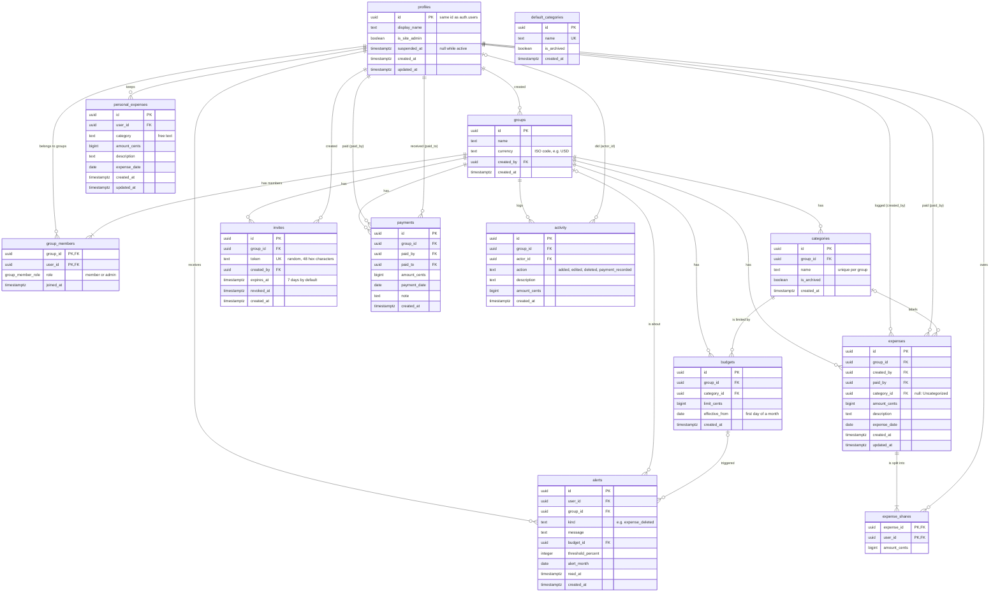

# Database

CommonPot uses PostgreSQL in Supabase. The schema exists only as migration files in [supabase/migrations/](../supabase/migrations/); nobody edits tables in the dashboard. Every table has row level security (RLS), so the database itself decides who can read or write each row, whatever the app does.

- Money is `bigint` integer cents in columns ending in `_cents`; there are no floats.
- Timestamps are `timestamptz`; calendar dates (an expense's date, a budget month) are `date`.
- Balances, budget progress and personal totals are never stored. `src/lib/domain` calculates them from expenses, shares and payments.

## Schema diagram

The diagram lists every table and column the migrations create. [tests/unit/docs.test.ts](../tests/unit/docs.test.ts) parses the migrations and fails if a table or column is missing here, so it can't drift.

`profiles.id` is also a foreign key to Supabase's own `auth.users`, which holds emails and password hashes; a trigger creates the profile when someone signs up.

## Tables

| Table                | What it holds                                                                                                            |
| -------------------- | ------------------------------------------------------------------------------------------------------------------------ |
| `profiles`           | One row per account: display name, site admin flag and suspension time                                                   |
| `groups`             | A shared account and its currency                                                                                        |
| `group_members`      | Who is in which group, as `member` or `admin`                                                                            |
| `default_categories` | The site-wide starting categories; copied into every new group                                                           |
| `categories`         | A group's own categories; archived ones stay on old expenses but aren't offered for new ones. Names are unique per group |
| `invites`            | Invite links: a random token, an expiry and an optional revocation                                                       |
| `expenses`           | A group expense: who logged it, who paid, the amount, category and date                                                  |
| `expense_shares`     | How one expense is split: each person's share in cents                                                                   |
| `payments`           | A settle-up payment recorded between two members                                                                         |
| `budgets`            | A monthly limit for one category, from a given month on (unique per group, category and month; no UI yet, US7)           |
| `alerts`             | In-app alerts for one user, such as "an admin deleted your expense"; one per user, budget, month and threshold           |
| `activity`           | The group feed. Written only by triggers, and the source of live updates                                                 |
| `personal_expenses`  | A user's private ledger, with a free-text category                                                                       |

## Rules the database enforces

Some rules hold even if a buggy or malicious client calls the database directly:

- **A split always adds up.** The deferred constraint triggers `expense_shares_total`, `expense_amount_matches_shares` and `expense_requires_shares` check at commit that an expense has at least one share and that its shares add up to its amount.
- **A group always has an admin.** The deferred constraint trigger `group_requires_admin` rejects any change that leaves a group without one, which is why the last admin can't leave or step down.
- **Rows point into the right group.** `validate_expense_relationships`, `validate_share_relationship`, `validate_payment_relationships` and `validate_budget_category` check that the payer, share holders, category and payment parties belong to the same group. An expense can't move to another group or change who logged it.
- **Privileges only change on the server.** `protect_profile_privileges` lets only the service role change `is_site_admin` or `suspended_at`, and `protect_alert_update` lets a user change nothing but `read_at` on their alerts.
- **Setup happens automatically.** `handle_new_user` creates the profile on sign-up, `add_group_creator` makes the creator the group's first admin, and `copy_default_categories` gives a new group the default categories.
- **The feed writes itself.** `record_expense_activity`, `record_expense_deletion` and `record_payment_activity` add an `activity` row for every new, changed or deleted expense and every payment. When an admin deletes someone else's expense, `record_expense_deletion` also sends that person an alert.

## Row level security

Every table has the policies below. On top of them, [20261114100000_block_suspended_users.sql](../supabase/migrations/20261114100000_block_suspended_users.sql) adds the restrictive policy `suspended_users_blocked` to every table, so a suspended user can't read or write anything, even with a token they already hold.

| Table                | Read                                     | Write                                                                                                                           |
| -------------------- | ---------------------------------------- | ------------------------------------------------------------------------------------------------------------------------------- |
| `profiles`           | Yourself; site admins see everyone       | Update yourself only (not the privilege columns)                                                                                |
| `groups`             | Members; site admins                     | Anyone signed in creates a group as themselves; admins rename it                                                                |
| `group_members`      | Members of that group                    | Admins change or remove other members, never their own row; joining goes through `accept_invite`, leaving through `leave_group` |
| `default_categories` | Site admins                              | Site admins                                                                                                                     |
| `categories`         | Members                                  | Admins                                                                                                                          |
| `invites`            | Admins                                   | Admins (created as themselves)                                                                                                  |
| `expenses`           | Members                                  | Members add as themselves; only the person who logged it edits it; they or an admin delete it                                   |
| `expense_shares`     | Members of the expense's group           | Only the person who logged the expense                                                                                          |
| `payments`           | Members                                  | Members record or delete a payment they are part of                                                                             |
| `budgets`            | Members                                  | Admins                                                                                                                          |
| `alerts`             | Only the recipient                       | The recipient marks it read; new alerts come from triggers                                                                      |
| `activity`           | Members                                  | Nobody directly: only triggers                                                                                                  |
| `personal_expenses`  | Only the owner, not group or site admins | Only the owner                                                                                                                  |

`is_group_member`, `is_group_admin` and `is_site_admin` are security definer helpers the policies call; since #48 they return false for suspended users. The integration tests check these rules with real tokens, for example that a user in one group can't read another group and that nobody but the owner can read a personal ledger.

## Functions the app calls

| Function                                            | Security | What it does                                                                               |
| --------------------------------------------------- | -------- | ------------------------------------------------------------------------------------------ |
| `create_expense(p_expense, p_shares)`               | invoker  | Inserts an expense and its shares in one transaction, so RLS and every trigger still apply |
| `update_expense(p_expense_id, p_expense, p_shares)` | invoker  | Replaces an expense and its shares in one transaction                                      |
| `accept_invite(p_token)`                            | definer  | Joins the group of a valid, unexpired, unrevoked invite; refuses suspended users           |
| `leave_group(p_group_id)`                           | definer  | Removes only the caller's own membership; the last admin can't leave                       |
| `group_member_profiles(p_group_id)`                 | definer  | Display names of a group's members, for members of that group only                         |
| `platform_counts()`                                 | definer  | User, group and expense counts for the site admin dashboard; site admins only              |
| `admin_list_users()`, `admin_list_groups()`         | definer  | The site admin tables: dates and counts, never amounts; site admins only                   |

Every function in this table revokes access from `anon` (signed-out callers), and every security definer function sets an empty `search_path`, so it can't be tricked into using another schema's objects.

## Realtime

[20261114035217_enable_realtime_activity_alerts.sql](../supabase/migrations/20261114035217_enable_realtime_activity_alerts.sql) adds `activity` and `alerts` to the `supabase_realtime` publication. Realtime applies RLS, so a client only hears about its own groups' activity and its own alerts. Why live updates come from `activity` rather than from `expenses`: [ADR 0004](decisions/0004-live-updates-from-activity.md).

## Migrations

| File                                                 | Change                                                                    |
| ---------------------------------------------------- | ------------------------------------------------------------------------- |
| `20261103220000_create_commonpot_schema.sql`         | All tables, triggers, RLS policies and functions (#4; edited once in #52) |
| `20261114035217_enable_realtime_activity_alerts.sql` | Realtime for `activity` and `alerts` (#11)                                |
| `20261114090000_add_site_admin_lists.sql`            | `admin_list_users` and `admin_list_groups` (#17)                          |
| `20261114100000_block_suspended_users.sql`           | Suspended users are blocked everywhere (#17)                              |
| `20261114110000_add_leave_group.sql`                 | `leave_group` (#16)                                                       |
